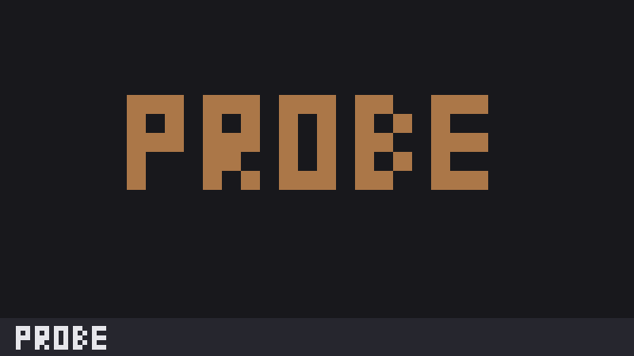

# Crawl probe

A one-line strip at the bottom of the window that says "probe". Clicking it posts a
"probe" toast. It exists only to test herdr.dev's Community crawler and will be deleted.

**What you see:** a 28px strip docked at the bottom, on the theme's `surface` color, with
"probe" in the `foreground` color followed by "click for a toast" in `muted`, both 12px,
10px from the left edge. Hovering turns the strip `raised`.

**How it behaves:** it ignores agent status. A click posts `notify({ title: "probe",
body: "Crawl probe clicked N×", level: "info", timeout: 3000 })`, counting clicks since
the mod loaded. There are no keys.

**Built from:** one mod, `mods/crawl-probe/` (`main.js`, `mod.json` with
`{ "place": "bottom", "size": 28 }`). It uses `notify` and `theme` from `herdr`, and
`h_flex` and `div` from the UI kit. It runs no programs and reaches no network.

**Watch out:** it is a test fixture, not a useful mod. The click counter resets when the
mod reloads.

**Done when:** `herdr-app check mods/crawl-probe` passes, the strip shows "probe" at the
bottom, and a click shows a "probe" toast.
