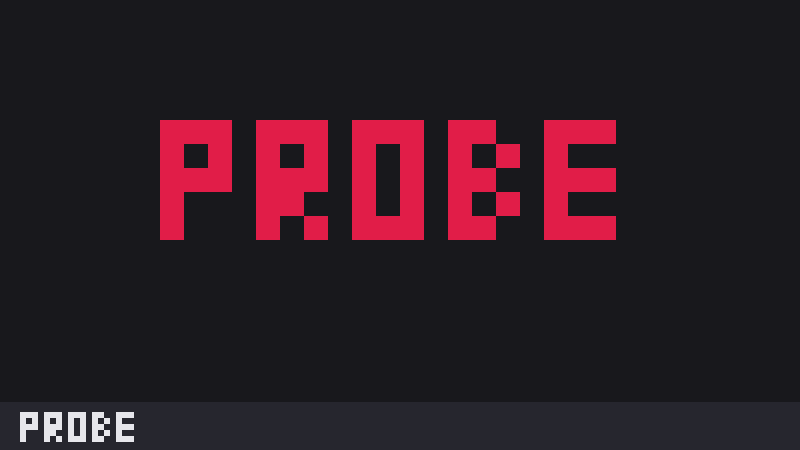

# Crawl probe layout

The tab bar on top, the active tab's terminals in the middle and a one-line "probe" strip at the bottom. It exists
only to test herdr.dev's Community crawler and will be deleted.

**What you see:** top to bottom: Herdr's tab bar (38px, draggable as the window title), the active tab's panes
filling the rest, and the `crawl-probe` strip (28px) saying "probe".

**How it behaves:** the tab bar and panes behave as Herdr's defaults. A click on the strip posts a "probe" toast.

**Built from:** a column of three blocks: `{ mod: "tabs" }`, `{ tab: "active" }` and `{ mod: "crawl-probe" }`.
`crawl-probe` is the probe mod (`notify` and `theme` from `herdr`). It is not in this folder: it is the repo's root
mod entry, `mods/crawl-probe/`, so add that mod first. `tabs` is Herdr's shipped tab bar.

**Watch out:** it is a test fixture, not a useful layout. Without the root `crawl-probe` mod the bottom strip is empty. It sets no theme or colors, so it follows the person's.

**Done when:** `layout.switch {name: "crawl-probe"}` shows the tab bar, the panes and the probe strip, and a click
on the strip shows a "probe" toast.
